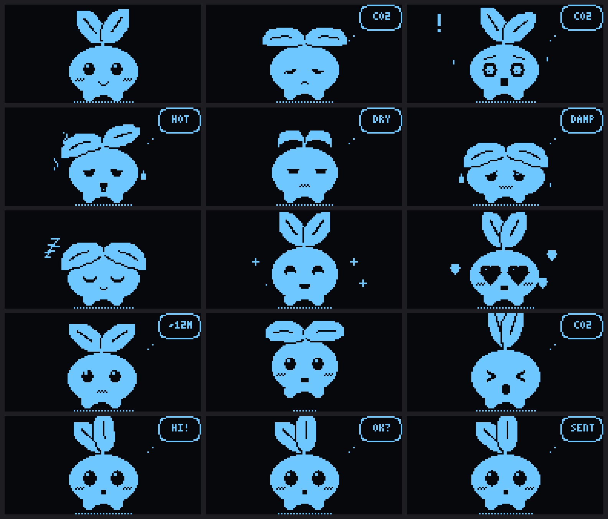

# Pip, the air pet

Pip sits on my bedroom wall and reads the air, mostly CO2, the gas we breathe out. Its face shows how the room feels, and a small bubble shows why.

I built it to test one question: can a room's air alone tell you someone is there, with no camera and no microphone?



- **The story, with the build and the real data:** https://rayasurya.com/projects/pip/
- **Try the room diary, on a simulated room:** https://rayasurya.com/projects/pip/diary/
- I built Pip alone in October 2026, with AI. I made every decision, and I'd never soldered before.

## What it does

- **Moods from the air.** CO2, temperature and humidity become a face, such as happy, stuffy, gasping, hot or asleep.
- **The face says how it feels, the bubble says why.** `CO2`, `HOT`, `DRY` or `DAMP`. When the air is bad, the bubble shows a window, which is the fix.
- **Touch.** A tap pets it. A long press explains in words, like "CO2 1,450 ppm. Open a window?"
- **A forecast.** A tiny neural network on the chip warns about stuffy air before it arrives. It was trained on simulated rooms (see below for how that went).
- **Night mode.** The clock turns the screen off from 21:30 to 07:30. Sensing and logging carry on.
- **A log and a dashboard.** It logs every minute and serves a dashboard on the home network. Uploads go over Wi-Fi.
- **Quotes.** Every half hour, a line from a public-domain book is typed onto the screen.

## What three weeks in a real room showed

Pip has logged my room every minute since 19 October 2026. These are totals from about 17,000 readings, up to 7 November. The raw data is private.

- **The forecast failed in the real room.** Its average miss 20 minutes ahead was 86 ppm. Just guessing "no change" missed by 27 ppm. In simulation it had caught 87% of stuffy spells 5 or more minutes early. That number is simulated.
- **It missed me asleep, so I changed the rule.** The first rule looked for rising CO2. A sleeper holds CO2 steady, so it almost never saw me. I rewrote it to read the level. On the days I held back for testing (log up to 8 November), the new rule called the room occupied for 100% of 1,001 sleeping minutes and 0% of 1,158 weekday-daytime minutes. On the same nights the first rule caught 1.3%. That is 4 nights and 4 weekdays in one room, scored against my routine, not a record of where I was. In a closed simulated room it fails the other way: it says "here" for hours after the person leaves. The rule, its tests and a room diary built on it are in `ai/presence/`. See [`ai/README.md`](ai/README.md).
- **As the user, I broke my own data.** The screen kept me awake, so I switched Pip off at night. 12 of 19 nights have holes. Night mode came from that.

Nobody else has used Pip or tested its faces. It's one room and one person.

## Parts

| Part | Pin |
|---|---|
| ESP32 dev board, 30 pins | |
| SCD40 CO2 sensor (also reads temperature and humidity) | I2C: SDA D21, SCL D22 |
| 1.3" OLED, 128x64, SH1106 | I2C: SDA D21, SCL D22 |
| Touch pad, TTP223 | D27 |
| Light sensor module | D34 |
| Passive buzzer | D25 |

The whole order, with tools, came to about ₹5,570. The wiring is in [`docs/wiring.svg`](docs/wiring.svg), and every step I took, with what went wrong, is in [`BUILD_STEPS.md`](BUILD_STEPS.md).

## Run it

You need [PlatformIO](https://platformio.org/).

```bash
cd firmware
pio test -e native
```
Runs the 109 tests on your computer. No board needed.

```bash
cp src/secrets.example.h src/secrets.h
pio run -e esp32dev -t upload
```
Fill in `secrets.h` first (Wi-Fi name and password, and an upload password you make up). It's ignored by git.

```bash
../tools/preview/run.sh
```
Draws every mood as a GIF on your computer, with the same drawing code the device uses.

The forecast, the simulator and the diary run in Python. See [`ai/README.md`](ai/README.md).

## What is where

| Folder | What's in it |
|---|---|
| `firmware/` | The ESP32 program and its tests. Start with `firmware/README.md`. |
| `ai/` | The room simulator, the forecast training, the diary, and the car and room experiments. All simulated, except `ai/presence/`. |
| `tools/` | The Mac preview, voice clips, log download and archive scripts. |
| `art/` | Pip's character sheet and the pixel versions. |
| `preview-out/` | Rendered moods and screens. |
| `DESIGN.md` | How Pip's character and moods were designed. |
| `BUILD_STEPS.md` | The build log, step by step. |
| `ROOM_MODE.md`, `LEFT_BEHIND.md` | Two simulated experiments: fresh air per person in a shared room, and a child left in a parked car. |

## Not in this repo

- My room's data. Only totals are published.
- Wi-Fi and upload passwords.
- The presence engine that `ai/presence/real_pip.py` runs on. That script shows the method, but it won't run on its own.
